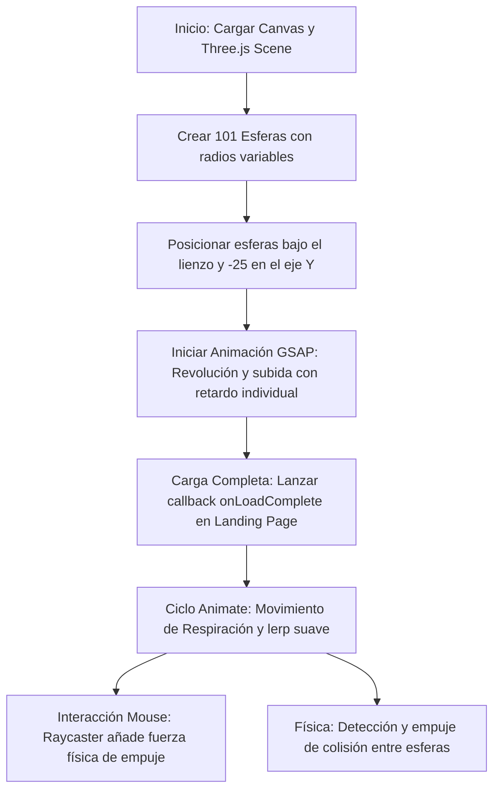

# 📂 1. Arquitectura General y Tecnologías del Sistema

Este documento describe la arquitectura global de **Ventus Barber App v2**, detallando el stack tecnológico, la jerarquía de directorios, la estrategia de rendering y el funcionamiento interno del sistema interactivo 3D.

---

## 🛠️ Stack Tecnológico Core

La aplicación está construida sobre tecnologías modernas de vanguardia en desarrollo web:

1. **Next.js 16.1.1 (App Router)**: Framework de React que gestiona el enrutamiento híbrido (Server Components y Client Components), rutas de API serverless y optimizaciones automáticas.
2. **React 19.2.3**: Librería UI de última generación que proporciona soporte nativo para async/await en server actions, hooks avanzados y soporte mejorado de renderizado de componentes.
3. **Prisma ORM 5.22.0**: ORM de tipado estático nativo para interactuar con la base de datos PostgreSQL, administrando migraciones, consultas optimizadas y tipado autogenerado.
4. **Tailwind CSS v4 & PostCSS 4**: Framework CSS optimizado por compilador (v4) que elimina utilidades innecesarias y compila estilos a nivel de CSS nativo.
5. **Material UI (MUI) v7.3.6 & @emotion**: Sistema de componentes de diseño utilizado específicamente para controles complejos como DatePickers interactivos y chips estables en formularios.
6. **Three.js & GSAP**: Motores gráficos y de animación en 3D de alta fidelidad, utilizados para el renderizado del lienzo del Landing Page.

---

## 📁 Estructura del Proyecto

El código fuente reside principalmente en la carpeta `/src`. La estructura se detalla a continuación:

```
ventus-app-v2/
├── agent/                         # [NUEVO] Documentación técnica persistente (este directorio)
├── prisma/                        # Esquema de base de datos y scripts de seeding
│   ├── dev.db                     # Base de datos SQLite local para pruebas rápidas
│   ├── schema.prisma              # Modelo relacional principal de base de datos
│   └── seed.ts                    # Script de sembrado de datos iniciales
├── public/                        # Recursos públicos estáticos (favicons, imágenes, etc.)
└── src/                           # Directorio principal del código de la aplicación
    ├── app/                       # Enrutamiento App Router de Next.js
    │   ├── admin/                 # Rutas de administración (Login y CMS)
    │   │   ├── cms/               # Dashboard administrativo protegido por middleware
    │   │   └── login/             # Pantalla de acceso del administrador
    │   ├── api/                   # Rutas de la API Backend de la aplicación
    │   ├── confirmed-shifts/      # Pantalla pública post-reserva exitosa
    │   ├── services/              # Catálogo público de servicios
    │   ├── shifts/                # Formulario público de solicitud de reserva
    │   ├── globals.css            # Estilos globales y variables Tailwind v4
    │   ├── layout.tsx             # Envoltura HTML y fuentes globales
    │   └── page.tsx               # Página de inicio interactiva (Landing Page)
    ├── components/                # Componentes UI globales reutilizables
    │   ├── ui/                    # Componentes atómicos (botones, inputs, chips custom)
    │   ├── AnimatedSpheres.tsx    # Sistema interactivo 3D de esferas (Three.js + GSAP)
    │   ├── CustomCursor.tsx       # Cursor customizado interactivo
    │   └── navbar.tsx             # Barra de navegación principal del cliente
    ├── core/                      # Tipos globales y esquemas Zod reutilizables
    │   ├── domain/                # Tipos de entidades core (e.g. Admin)
    │   └── schemas/               # Validaciones Zod (e.g. Login Schema)
    ├── features/                  # Módulos organizados por dominio siguiendo Clean Architecture
    │   └── expenses/              # Feature de gestión financiera (gastos y cobros)
    ├── hooks/                     # Custom React hooks de negocio global (useAuth, useAdmin)
    └── lib/                       # Utilidades de bajo nivel y librerías externas (Prisma, JWT, Cookies)
```

---

## 🏎️ Estrategia de Rendering de Next.js

La aplicación utiliza un enfoque híbrido optimizado para rendimiento de carga y consistencia de datos:

### A. Páginas del Servidor (Server Components - RSC)
Las vistas del panel de administración (CMS) consumen datos directamente de la base de datos sin peticiones HTTP intermedias:
- **`src/app/admin/cms/page.tsx`**: Marcado como `force-dynamic` y `revalidate = 0`. Esto fuerza a que cada petición calcule dinámicamente las estadísticas del día y los últimos turnos desde Prisma en tiempo real.

### B. Páginas del Cliente (Client Components)
Las páginas que requieren interacciones fluidas, animaciones o estados locales dinámicos se renderizan en el cliente:
- **`src/app/page.tsx`**: Carga el lienzo de Three.js, maneja transiciones con Framer Motion, e integra el formulario interactivo de **reseñas anónimas y el historial** con inserciones reactivas en tiempo real.
- **`src/app/shifts/page.tsx`**: El wizard de reserva del cliente administra múltiples peticiones asíncronas para actualizar selectores de horas a medida que cambia la ubicación y fecha.
- **`src/features/expenses/ui/expenses-page.tsx`**: Utiliza hooks locales reactivos para gestionar diálogos interactivos de creación/edición de finanzas sin refrescar el navegador.

---

## 🎨 Sistema de Animación y Estética Visual 3D

El aspecto visual del proyecto destaca por su alto nivel de pulido ("Wow factor") y una **estética minimalista inspirada en Apple pero con bordes rectos y nítidos** (cero redondeados, aplicando estrictamente `rounded-none` en todo el flujo de cara al cliente). El dinamismo y el pulido premium están impulsados por los siguientes componentes clave en `src/components`:

### 🔮 Canvas de Esferas Interactivas (`AnimatedSpheres.tsx`)
Renderiza un entorno tridimensional con 101 esferas de diferentes radios flotando armoniosamente. El sistema sigue estos pasos lógicos:



- **GSAP Revolution**: Durante los primeros 3 segundos, las esferas realizan una espiral ascendente en el eje Z mediante senos matemáticos, creando una transición de carga de primer nivel.
- **Fuerzas de Raycaster**: Al pasar el ratón, se calcula una fuerza de repulsión radial en base a la colisión del puntero, empujando suavemente las esferas.
- **Detección de Colisiones**: En cada frame se evalúa si la distancia euclidiana entre dos esferas es menor que la suma de sus radios (multiplicada por un factor de holgura `1.2`). Si colisionan, se les aplica un desplazamiento corrector proporcional para evitar solapamientos visuales.

### 🖱️ Custom Cursor (`CustomCursor.tsx`)
Reemplaza el cursor estándar del navegador por un elemento visual interactivo:
- Se dibuja un puntero flotante negro con un borde blanco que sigue la posición del mouse con un retraso físico usando `framer-motion` y constantes de amortiguación (spring physics).
- Proporciona una respuesta háptica visual de alta calidad en toda la página de inicio.

---

## 🔗 Referencias Cruzadas Internas

- **Autenticación**: Para ver cómo se protegen las rutas que renderizan esta arquitectura, consulta la [Documentación del Sistema de Autenticación](file:///home/otochi/Desktop/works/ventus-app-v2/agent/auth-system.md).
- **Base de Datos**: Para comprender el modelado subyacente que consume Prisma, visita la [Documentación del Esquema de Datos](file:///home/otochi/Desktop/works/ventus-app-v2/agent/database-schema.md).
- **Reseñas Anónimas**: Para conocer en detalle la arquitectura de la API de opiniones y el flujo de estrellas interactivo, visita la [Documentación del Sistema de Reseñas](file:///home/otochi/Desktop/works/ventus-app-v2/agent/reviews-system.md).
