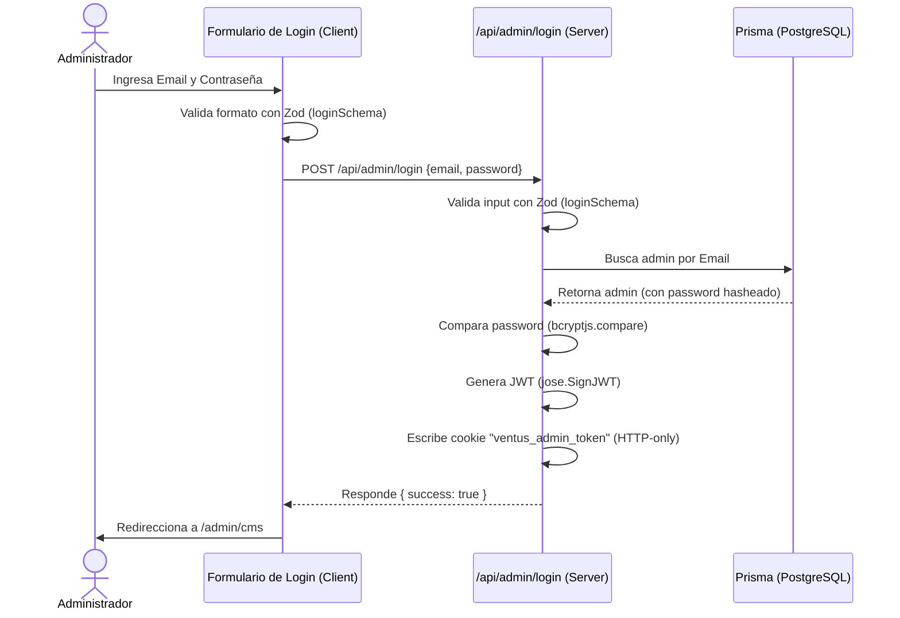

# 🔐 2. Sistema de Autenticación y Autorización

Este documento describe el flujo completo de autenticación, autorización y seguridad de **Ventus Barber App v2**. La aplicación implementa un sistema robusto y personalizado basado en **JSON Web Tokens (JWT)** y cookies del lado del servidor para proteger el panel de administración (CMS) y sus APIs.

---

## 🔒 Flujo Completo de Autenticación (Login)

La autenticación está reservada exclusivamente para administradores. El flujo de login sigue los siguientes pasos secuenciales:



### 1. Validación de Datos (Zod)
Tanto en el cliente (`LoginForm.tsx`) como en el servidor (`route.ts`), los datos de acceso se validan mediante el esquema Zod `loginSchema` definido en [auth.schema.ts](file:///home/otochi/Desktop/works/ventus-app-v2/src/core/schemas/auth.schema.ts):

```typescript
import { z } from "zod";

export const loginSchema = z.object({
    email: z.string().email("Email inválido"),
    password: z.string().min(6, "La contraseña debe tener al menos 6 caracteres"),
});

export type LoginInput = z.infer<typeof loginSchema>;
```

### 2. Comparación de Contraseña
Las contraseñas se almacenan de manera segura utilizando **Bcryptjs** con un costo de encriptación de 10 rounds de sal. La verificación se realiza asíncronamente en [password.ts](file:///home/otochi/Desktop/works/ventus-app-v2/src/lib/password.ts):
```typescript
import * as bcrypt from "bcryptjs";

export async function comparePassword(password: string, hashedPassword: string): Promise<boolean> {
    return bcrypt.compare(password, hashedPassword);
}
```

### 3. Creación y Firmado del JWT
Una vez autenticado el administrador, se crea un token JWT firmado digitalmente con el algoritmo **HS256** utilizando la librería `jose`. El payload del JWT contiene:
- `adminId`: Identificador único de base de datos del administrador.
- `email`: Correo electrónico del administrador.

La lógica se implementa en [jwt.ts](file:///home/otochi/Desktop/works/ventus-app-v2/src/lib/jwt.ts):
```typescript
import { SignJWT, jwtVerify } from "jose";

const secret = new TextEncoder().encode(process.env.JWT_SECRET || "ventus-secret-key-fallback");

export type JWTPayload = {
    adminId: string;
    email: string;
};

export async function signToken(payload: JWTPayload): Promise<string> {
    return new SignJWT(payload)
        .setProtectedHeader({ alg: "HS256" })
        .setIssuedAt()
        .setExpirationTime(process.env.JWT_EXPIRES_IN || "7d")
        .sign(secret);
}
```

---

## 🍪 Gestión de Sesión mediante Cookies HTTP-only

Para mitigar ataques de **Cross-Site Scripting (XSS)**, la aplicación no almacena el JWT en el `localStorage` o `sessionStorage` del navegador. En su lugar, utiliza cookies seguras configuradas del lado del servidor.

### Configuración de la Cookie
La cookie se llama `ventus_admin_token` y se expone con la siguiente configuración en [cookies.ts](file:///home/otochi/Desktop/works/ventus-app-v2/src/lib/cookies.ts):

| Propiedad | Valor | Razón de Seguridad |
| :--- | :--- | :--- |
| `httpOnly` | `true` | Evita que scripts JS cliente lean el token (Protección contra XSS). |
| `secure` | `process.env.NODE_ENV === "production"` | Solo se transmite a través de conexiones cifradas HTTPS en producción. |
| `sameSite` | `"lax"` | Protege la cookie de ser enviada en solicitudes cruzadas (Protección contra CSRF). |
| `maxAge` | `60 * 60 * 24 * 7` (7 días) | Determina la duración de la sesión del administrador. |
| `path` | `"/"` | Disponible para todas las rutas del sitio. |

El ciclo de vida de la cookie (escritura, obtención y eliminación) se gestiona de forma nativa utilizando `cookies()` de Next.js.

---

## 🛡️ Control de Acceso y Protección de Rutas

### 1. Interceptación Global: Middleware de Next.js
Cualquier solicitud de página dentro del panel de administración (`/admin/cms/:path*`) es interceptada a nivel de servidor por el archivo [middleware.ts](file:///home/otochi/Desktop/works/ventus-app-v2/middleware.ts):

- **Verificación de Cookie**: Si la cookie `ventus_admin_token` no existe en la cabecera, se redirige inmediatamente al usuario a `/admin/login`.
- **Verificación de Token**: Si la cookie existe, se valida su firma y expiración mediante `verifyToken`. Si la validación falla, se elimina la cookie del navegador (limpieza de sesión) y se redirige a `/admin/login`.
- **Match de Rutas**: Configurado mediante un matcher para aplicar únicamente a `/admin/cms/:path*`.

```typescript
export const config = {
    matcher: ["/admin/cms/:path*"],
};
```

### 2. Protección de APIs: Guardia Programático (`requireAuth`)
Para proteger las APIs backend frente a accesos no autorizados (ya que el middleware de Next.js solo bloquea rutas del navegador `/admin/cms/*`), se utiliza el guardia [auth-guard.ts](file:///home/otochi/Desktop/works/ventus-app-v2/src/lib/auth-guard.ts):

```typescript
import { getAuthCookie } from "./cookies";
import { verifyToken } from "./jwt";
import type { JWTPayload } from "./jwt";

export async function requireAuth(): Promise<JWTPayload> {
    const token = await getAuthCookie();

    if (!token) {
        throw new Error("No autenticado");
    }

    const payload = await verifyToken(token);

    if (!payload) {
        throw new Error("Token inválido o expirado");
    }

    return payload;
}
```

#### Ejemplo de uso en APIs administrativas (`POST /api/expenses`):
```typescript
import { requireAuth } from "@/lib/auth-guard";

export async function POST(request: Request) {
    try {
        // Validación obligatoria de sesión administrativa
        await requireAuth(); 
        
        // ... lógica del endpoint
    } catch (error) {
        if (error instanceof Error && error.message.includes("autenticado")) {
            return NextResponse.json(
                { error: "No autorizado. Se requiere autenticación de admin." },
                { status: 401 }
            );
        }
        return NextResponse.json({ error: "Error interno" }, { status: 500 });
    }
}
```

---

## 🔗 Referencias Cruzadas Internas

- **Endpoints y APIs**: Para ver una lista de APIs protegidas que consumen este sistema, consulta la [Documentación del CMS de Administración](file:///home/otochi/Desktop/works/ventus-app-v2/agent/cms-dashboard.md).
- **Esquemas Prisma**: Para ver los datos asociados al modelo `Admin` y `User`, consulta la [Documentación del Esquema de Base de Datos](file:///home/otochi/Desktop/works/ventus-app-v2/agent/database-schema.md).
