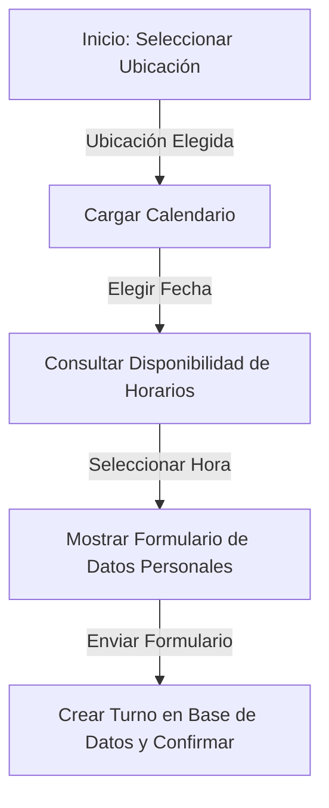

# 📅 4. Asistente de Reserva de Turnos (Booking Flow)

> [!NOTE]
> **Estado Temporal**: Los accesos directos y botones del asistente de reservas público (`/shifts`) y la visualización de turnos confirmados (`/confirmed-shifts`) se encuentran **ocultos temporalmente en el frontend** por decisión de diseño de UI/UX, simplificando la interfaz del cliente. No obstante, la lógica del backend y los flujos siguen 100% operativos.

Este documento detalla el funcionamiento del asistente de reservas público de **Ventus Barber App v2** ubicado en la ruta `/shifts`. Describe tanto el flujo interactivo de la interfaz de usuario como el algoritmo lógico del backend que calcula la disponibilidad en tiempo real y detecta horarios de alta demanda.

---

## 🗺️ Flujo de Usuario Paso a Paso (UI/UX)

El asistente de reservas es un formulario guiado e interactivo que recopila de manera ordenada los datos requeridos para programar una cita. Está estructurado en 4 fases secuenciales controladas por dependencias de estados locales:



### Paso 1: Selección de Ubicación
- El cliente inicia seleccionando una sucursal en un selector personalizado (`Select` customizado).
- Los datos se consultan dinámicamente de `GET /api/locations` (con cabecera `cache: "no-store"` para evitar desfases).
- Al cambiar la sucursal, se limpian los estados de fecha, horarios y hora seleccionada para evitar inconsistencias cruzadas.

### Paso 2: Selección de Fecha (DatePicker adaptado)
- Una vez elegida la sucursal, se carga el componente `@mui/x-date-pickers/DatePicker` localizado en español (`es`).
- **Bloqueos de Calendario**: La interfaz deshabilita dinámicamente dos tipos de fechas:
  1. Fechas pasadas (anteriores al día de hoy).
  2. Fechas bloqueadas específicamente para esa sucursal, obtenidas de `GET /api/unavailable-dates?locationId={id}`.
- Las fechas deshabilitadas se muestran tachadas visualmente para el cliente.

### Paso 3: Selección de Horario (Chip System)
- Al seleccionar una fecha válida, se ejecuta una consulta asíncrona a `GET /api/shifts/available-slots?locationId={id}&date={YYYY-MM-DD}`.
- Los horarios disponibles se renderizan en una cuadrícula utilizando el componente `Chip`.
- **🔴 Alta Demanda**: Si un slot horario tiene múltiples solicitudes de reserva sin confirmar, se resalta visualmente en color naranja con un punto pulsante y se muestra una advertencia informativa debajo indicando que ese slot tiene alta competencia.
- Si el día no cuenta con cupos libres, se presenta una tarjeta informativa notificándolo.

### Paso 4: Datos Personales e Inscripción
- Al hacer clic en un horario libre, se despliega una sección del formulario para capturar los datos de contacto:
  - Nombre y Apellido
  - Email (formato de correo electrónico válido)
  - Teléfono (contacto celular)
- El botón de envío se activa únicamente cuando todos los campos están completos y validados (`isFormValid`).
- Al enviar, se hace un `POST /api/shifts` con los datos. Si la reserva es exitosa, se limpia el formulario y se muestra un mensaje de éxito.

---

## ⚙️ Algoritmo Backend de Disponibilidad (`available-slots`)

El cálculo de qué horarios se muestran libres u ocupados se realiza dinámicamente en el servidor en el endpoint [available-slots/route.ts](file:///home/otochi/Desktop/works/ventus-app-v2/src/app/api/shifts/available-slots/route.ts). El algoritmo sigue esta lógica de consulta y filtrado:

### 1. Inicialización y Parseo de Fechas
Se valida la presencia de `locationId` y `date` en los parámetros de la URL. La fecha (en formato `YYYY-MM-DD`) se desglosa en UTC para abarcar exactamente desde las `00:00:00.000` hasta las `23:59:59.999` del día elegido:

```typescript
const [year, month, day] = dateStr.split("-").map(Number);
const startOfDay = new Date(Date.UTC(year, month - 1, day, 0, 0, 0, 0));
const endOfDay = new Date(Date.UTC(year, month - 1, day, 23, 59, 59, 999));
```

### 2. Filtro de Fechas Inhabilitadas Globalmente
Se verifica si el día está bloqueado por el administrador para esa sucursal en particular. Si se encuentra un registro en `UnavailableDate`, el backend devuelve un array vacío `[]` inmediatamente:

```typescript
const isDateBlocked = await prisma.unavailableDate.findFirst({
    where: {
        locationId,
        date: { gte: startOfDay, lte: endOfDay },
    },
});

if (isDateBlocked) return NextResponse.json([]);
```

### 3. Carga y Mapeo de Plantillas de Horarios (`TimeSlot`)
Se recuperan todos los horarios configurados como plantilla de atención para esa sucursal:
```typescript
const allTimeSlots = await prisma.timeSlot.findMany({
    where: { locationId },
    orderBy: { time: "asc" },
});
```

### 4. Discriminación de Turnos Confirmados y Pendientes
Se extraen de forma paralela los turnos registrados para esa sucursal y fecha:
1. **Turnos Confirmados**: Reservas firmes. Cualquier horario asociado a un turno confirmado queda **excluido** del catálogo disponible de inmediato.
2. **Turnos Pendientes**: Reservas creadas por clientes que aún no han sido confirmadas por el administrador. Se realiza un conteo agrupado por hora (`pendingCountByTime`).

```typescript
const confirmedTimes = confirmedShifts.map((shift) => shift.time);

const pendingCountByTime = pendingShifts.reduce((acc, shift) => {
    acc[shift.time] = (acc[shift.time] || 0) + 1;
    return acc;
}, {} as Record<string, number>);
```

### 5. Retorno de Disponibilidad y Marcado de Alta Demanda
Se filtran los horarios plantilla que no estén ocupados por turnos confirmados y se evalúa si superan el umbral de alta demanda (definido como **dos o más solicitudes pendientes para el mismo horario**):

```typescript
const availableSlots = allTimeSlots
    .filter((slot) => !confirmedTimes.includes(slot.time))
    .map((slot) => ({
        ...slot,
        pendingCount: pendingCountByTime[slot.time] || 0,
        isHighDemand: (pendingCountByTime[slot.time] || 0) >= 2, // Umbral de negocio
    }));
```

---

## ⚡ Lógica de Registro Concurrentes y Restricciones (Negocio)

Cuando el cliente pulsa "Reservar", el controlador [src/app/api/shifts/route.ts](file:///home/otochi/Desktop/works/ventus-app-v2/src/app/api/shifts/route.ts) realiza validaciones de seguridad adicionales antes de insertar la cita:

- **Doble validación de fecha bloqueada**: Evita que se inyecten reservas en días inhabilitados mediante scripts maliciosos.
- **Validación de conflicto confirmado**: Si otro cliente acaba de confirmar un turno para el mismo horario y sucursal un milisegundo antes, el servidor rechaza la reserva lanzando un error HTTP 400:
  `"El horario seleccionado ya está ocupado por un turno confirmado"`.
- **Inserción**: Si pasa las comprobaciones, el turno se crea en estado pendiente (`confirmed: false` por defecto), listo para ser auditado en el CMS de administración.

---

## 🔗 Referencias Cruzadas Internas

- **Administración de Turnos**: Para ver cómo el administrador aprueba, edita o rechaza estas reservas entrantes, consulta la [Documentación del CMS de Administración](file:///home/otochi/Desktop/works/ventus-app-v2/agent/cms-dashboard.md).
- **Esquema de Sucursales**: Para ver las propiedades geométricas y relacionales de `Location` y `UnavailableDate`, consulta la [Documentación del Esquema de Base de Datos](file:///home/otochi/Desktop/works/ventus-app-v2/agent/database-schema.md).
