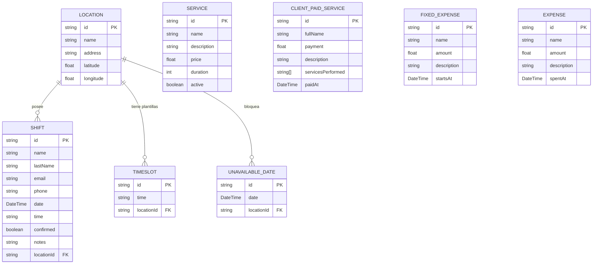

# 🗄️ 3. Esquema de Base de Datos y Persistencia

Este documento detalla la capa de datos de **Ventus Barber App v2**. El sistema utiliza **PostgreSQL** administrado a través de **Prisma ORM**, estructurado en base a un modelo relacional de alta consistencia para gestionar ubicaciones, turnos, horarios y la contabilidad financiera del negocio.

---

## 🗺️ Modelo de Entidad-Relación (Prisma)

El diseño de base de datos gira en torno a **`Location`** (sucursal física de la barbería), que actúa como el nodo relacional central para las agendas y disponibilidades.

---

## 📝 Detalle de Modelos y Restricciones

A continuación se analizan en profundidad los modelos definidos en [schema.prisma](file:///home/otochi/Desktop/works/ventus-app-v2/prisma/schema.prisma):

### 1. Gestión de Sucursales y Agendas

#### A. Modelo `Location`
Almacena las distintas sucursales de la barbería. Incluye coordenadas de geolocalización opcionales para la integración en mapas.
- **Campos**: `id` (cuid), `name`, `address`, `latitude` (Float?), `longitude` (Float?).
- **Relaciones**: Un `Location` tiene múltiples `Shift[]`, `TimeSlot[]` y `UnavailableDate[]`.

#### B. Modelo `TimeSlot`
Define los horarios teóricos en los que una sucursal puede atender turnos (e.g. 09:00, 09:30).
- **Campos**: `id`, `time` (String, formato HH:MM), `locationId`.
- **Restricciones**: Clave única compuesta `@@unique([locationId, time])`. Esto impide asignar el mismo horario duplicado en la plantilla de una sucursal específica.

#### C. Modelo `UnavailableDate`
Permite bloquear fechas completas para una sucursal determinada (días festivos, vacaciones).
- **Campos**: `id`, `date` (DateTime), `locationId`.
- **Restricciones**: Clave única compuesta `@@unique([locationId, date])`. Garantiza que una fecha se bloquee una sola vez por sucursal.

#### D. Modelo `Shift`
Representa una solicitud o reserva activa de turno realizada por un cliente.
- **Campos**: `id`, `name`, `lastName`, `email`, `phone`, `date` (DateTime), `time` (String), `confirmed` (Boolean, default `false`), `notes` (String?), `locationId`.
- **Negocio**: Cuando `confirmed` es `true`, ese horario queda bloqueado y bloquea la disponibilidad en las búsquedas públicas del cliente.

---

### 2. Gestión Financiera (Feature: Expenses)

#### A. Modelo `ClientPaidService`
Registra los cobros realizados a clientes por servicios prestados (Ingresos del negocio).
- **Campos**: `id`, `fullName`, `payment` (Float), `description`?, `servicesPerformed` (String[], lista de servicios realizados), `paidAt` (DateTime).
- **Índices**: 
  - `@@index([fullName])` - Acelera búsquedas de historial de pagos por nombre de cliente.
  - `@@index([paidAt])` - Acelera filtrados y sumas agregadas por rangos de fecha en el balance.

#### B. Modelo `FixedExpense`
Plantillas de gastos fijos mensuales recurrentes (e.g., alquiler, luz, internet).
- **Campos**: `id`, `name`, `amount`, `description`?, `startsAt` (DateTime, fecha de inicio del ciclo).
- **Índices**: 
  - `@@index([startsAt])` - Filtra qué plantillas de gastos fijos estaban activas antes de la fecha límite de un rango mensual.
  - `@@index([name])` - Acelera búsquedas administrativas por nombre del gasto fijo.

#### C. Modelo `Expense`
Gastos variables y únicos e imprevistos incurridos en el día a día (e.g., compra de insumos, café).
- **Campos**: `id`, `name`, `amount`, `description`?, `spentAt` (DateTime).
- **Índices**:
  - `@@index([spentAt])` - Permite búsquedas agregadas y sumas de gastos variables rápidas por períodos de tiempo.

---

### 3. Cuentas de Acceso y Servicios

#### A. Modelo `Admin`
Credenciales de acceso para gestionar el panel administrativo CMS.
- **Campos**: `id`, `email` (único), `name`?, `password` (hasheada).

#### B. Modelo `User`
Registros generales de usuarios (previsto para futuras expansiones de perfiles de clientes).
- **Campos**: `id`, `email` (único), `name`?, `password`.

#### C. Modelo `Service`
Catálogo de cortes y tratamientos ofrecidos por la barbería.
- **Campos**: `id`, `name`, `description`?, `price` (Float), `duration` (Int, en minutos), `active` (Boolean, default `true`).

---

## 🌱 Estrategia de Inicialización y Sembrado de Datos (Seed)

Para facilitar el desarrollo local y las pruebas, la base de datos se puede sembrar por completo mediante el script [seed.ts](file:///home/otochi/Desktop/works/ventus-app-v2/prisma/seed.ts). Al ejecutarse, realiza las siguientes acciones deterministas:

1. **Limpieza en Cascada**: Elimina todos los registros de `Shift`, `TimeSlot`, `UnavailableDate`, `Location`, `User`, `Admin` y `Service` en orden inverso de dependencias para evitar violaciones de claves foráneas.
2. **Creación de Ubicaciones**: Añade tres sucursales físicas:
   - `Ventus Palermo` (Av. Santa Fe 3456)
   - `Ventus Belgrano` (Av. Cabildo 2100)
   - `Ventus Centro` (Florida 650)
3. **Plantillas de Horarios**: Para cada una de las sucursales, genera 14 slots de tiempo predefinidos de atención (desde las `09:00` hasta las `17:00`).
4. **Fechas Inhabilitadas**: Bloquea una fecha específica para Palermo a 7 días en el futuro.
5. **Turnos de Prueba**: Genera múltiples turnos para el día de mañana (algunos marcados como `confirmed: true` y otros como `confirmed: false`) para simular la visualización en el dashboard y el comportamiento de "Alta Demanda".
6. **Catálogo de Servicios**: Siembra cortes como "Corte de Pelo" ($5000), "Corte de Barba" ($3000), etc.
7. **Acceso de Administrador**: Crea la cuenta administrativa semilla:
   - **Email**: `ventus@barber.com`
   - **Password**: `15651106asd` (hasheado mediante Bcryptjs).

---

## 🔗 Referencias Cruzadas Internas

- **Flujo de Turnos**: Para ver cómo impactan los registros de `Shift` e `UnavailableDate` en el proceso de reserva, consulta la [Documentación del Flujo de Reservas](file:///home/otochi/Desktop/works/ventus-app-v2/agent/booking-flow.md).
- **Gastos y Cobros**: Para comprender cómo interactúan los modelos de finanzas con la interfaz gráfica del panel, revisa la [Documentación del Módulo Financiero](file:///home/otochi/Desktop/works/ventus-app-v2/agent/finance-module.md).
