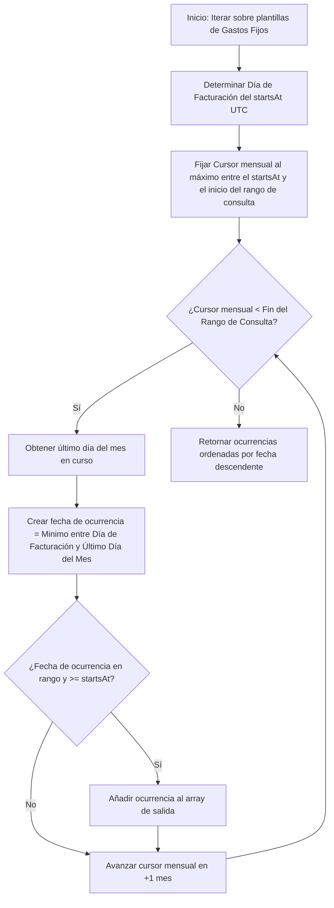

# 💼 5. Módulo Financiero y Clean Architecture

Este documento describe el **Módulo Financiero** de **Ventus Barber App v2**, el cual administra el control contable, los cobros por servicios y los egresos (tanto variables como fijos). Este módulo destaca por implementar una estructura modular basada en **Clean Architecture** y una lógica algorítmica avanzada para la proyección de gastos mensuales recurrentes.

---

## 🏛️ Estructura Clean Architecture (`src/features/expenses`)

Para garantizar la mantenibilidad y desacoplar la interfaz gráfica de la lógica matemática y de red, la funcionalidad de gastos está organizada bajo `/src/features/expenses` en cuatro capas independientes con responsabilidades claras:

```
src/features/expenses/
├── domain/                  # CAPA 1: Modelos, tipos y lógica matemática pura
│   ├── expenses.types.ts    # Definiciones de tipos (Records, States y Dialogs)
│   └── finance.ts           # Funciones puras de cálculo de fechas y recurrencias fijos
├── infrastructure/          # CAPA 2: Cliente API de red y persistencia
│   └── expenses.api.ts      # Funciones asíncronas fetch de cobros y gastos
├── hooks/                   # CAPA 3: React Hooks de Estado e Interacciones de Negocio
│   ├── use-expenses-data.ts     # Carga agregada de resumen, gastos y rangos de fechas
│   ├── use-expense-form.ts      # Formulario reactivo y PUT/POST de gastos variables
│   ├── use-fixed-expense-form.ts# Formulario reactivo y PUT/POST de gastos fijos
│   └── use-expense-delete.ts    # Lógica de eliminación y diálogos de confirmación
└── ui/                      # CAPA 4: Componentes visuales y páginas
    ├── expenses-page.tsx    # Vista contenedora principal (orquestador de hooks)
    ├── budget-hero.tsx      # Selector de rangos temporales (Preset/Custom)
    ├── summary-cards.tsx    # Tarjetas de balances (Ingresos, Gastos, Presupuesto)
    └── tables / dialogs     # Tablas estructuradas y diálogos de edición
```

---

## 📅 Lógica Contable de Rangos y Presupuestos

El sistema permite auditar la salud financiera del negocio agrupando los movimientos en tres períodos principales (`BudgetPeriod`): `"week" | "month" | "year"`, o mediante rangos de fechas personalizados (`startDate` y `endDate`).

### Sumas Agregadas Financieras:
Para cualquier rango temporal analizado `[start, end)`, el balance o saldo neto (**Presupuesto**) se define mediante la ecuación:

$$\text{Presupuesto (Neto)} = \text{Ingresos} - (\text{Gastos Variables} + \text{Gastos Fijos})$$

1. **Ingresos**: Suma agregada de los cobros en base al modelo `ClientPaidService` filtrados por `paidAt` en el rango.
2. **Gastos Variables**: Suma agregada del modelo `Expense` filtrados por `spentAt` en el rango.
3. **Gastos Fijos**: Suma proyectada de todas las ocurrencias mensuales de gastos fijos vigentes en el rango.

---

## 🧮 Algoritmo de Ocurrencias Mensuales de Gastos Fijos

### El Problema Técnico:
Un gasto fijo (e.g., alquiler contratado el 15 de enero de 2026) se guarda como una sola plantilla de gasto (`FixedExpense`) con una fecha de inicio (`startsAt`) y un monto fijo mensual. Si el administrador consulta el resumen financiero de la semana del 10 al 20 de febrero de 2026, el sistema debe proyectar matemáticamente si el cobro mensual de ese alquiler cae dentro de esa semana, resolviendo complejidades como duraciones de meses (28, 30 o 31 días) y años bisiestos.

### La Solución Algorítmica:
La función pura **`getFixedExpenseOccurrences`** en [finance.ts](file:///home/otochi/Desktop/works/ventus-app-v2/src/features/expenses/domain/finance.ts) proyecta las ocurrencias reales siguiendo este flujo:



### Implementación Técnica de la Lógica del Cursor:

```typescript
export function getFixedExpenseOccurrences(
    fixedExpenses: FixedExpenseSource[],
    range: Pick<PeriodRange, "start" | "end">
) {
    const occurrences: FixedExpenseOccurrence[] = [];

    for (const fixedExpense of fixedExpenses) {
        const startsAt = ensureDate(fixedExpense.startsAt);
        const billingDay = startsAt.getUTCDate();
        let cursor = getMonthStart(startsAt);
        const minimumCursor = getMonthStart(range.start);

        // Optimización: El cursor inicia en el mes donde el rango comienza a ser evaluado
        if (cursor < minimumCursor) {
            cursor = minimumCursor;
        }

        while (cursor < range.end) {
            const year = cursor.getUTCFullYear();
            const monthIndex = cursor.getUTCMonth();
            
            // Hallar el último día del mes real (e.g. Febrero = 28/29, Abril = 30)
            const lastDay = new Date(Date.UTC(year, monthIndex + 1, 0)).getUTCDate();
            
            // Evitar desbordes de mes (si el día de facturación es 31, pero el mes tiene 30 días, se cobra el 30)
            const occurrenceDate = new Date(
                Date.UTC(year, monthIndex, Math.min(billingDay, lastDay), 12, 0, 0, 0)
            );

            // Validar que la ocurrencia caiga estrictamente dentro del rango y sea posterior al alta de la plantilla
            if (
                occurrenceDate >= startsAt &&
                occurrenceDate >= range.start &&
                occurrenceDate < range.end
            ) {
                occurrences.push({
                    fixedExpenseId: fixedExpense.id,
                    name: fixedExpense.name,
                    amount: fixedExpense.amount,
                    description: fixedExpense.description,
                    occurrenceDate,
                });
            }

            // Incrementar cursor al siguiente mes calendario
            cursor = new Date(Date.UTC(cursor.getUTCFullYear(), cursor.getUTCMonth() + 1, 1, 0, 0, 0, 0));
        }
    }

    return occurrences.sort(
        (left, right) => right.occurrenceDate.getTime() - left.occurrenceDate.getTime()
    );
}
```

---

## ⚓ Hooks de Integración de Datos (React)

La UI consume la lógica a través del hook unificado **`useExpensesData`** en [use-expenses-data.ts](file:///home/otochi/Desktop/works/ventus-app-v2/src/features/expenses/hooks/use-expenses-data.ts):

- **Estado de Carga y Refresh**: Administra tres estados de carga asíncrona paralelos (`fetchSummary`, `fetchExpenses`, `fetchFixedExpenses`) coordinados mediante llamadas con caching desactivado (`cache: "no-store"`).
- **Rango Inteligente**: Almacena el preset activo (`week`, `month`, `year`) y las fechas `startDate`/`endDate` en estados reactivos. Si se produce un cambio en las fechas del DatePicker, recalcula los rangos y hace un refetch total automáticamente.
- **Validación del Cliente**: Marca la bandera `isInvalidDateRange` si el usuario selecciona una fecha de inicio posterior a la fecha de fin en el DatePicker, previniendo peticiones fallidas al servidor.

---

## 🔗 Referencias Cruzadas Internas

- **Esquema de Gastos**: Para ver los campos exactos del modelo `Expense` y `FixedExpense`, consulta la [Documentación del Esquema de Base de Datos](file:///home/otochi/Desktop/works/ventus-app-v2/agent/database-schema.md).
- **APIs de Resumen**: Para ver la integración en el backend de este cálculo de gastos fijos, consulta la [Documentación del CMS de Administración](file:///home/otochi/Desktop/works/ventus-app-v2/agent/cms-dashboard.md).
