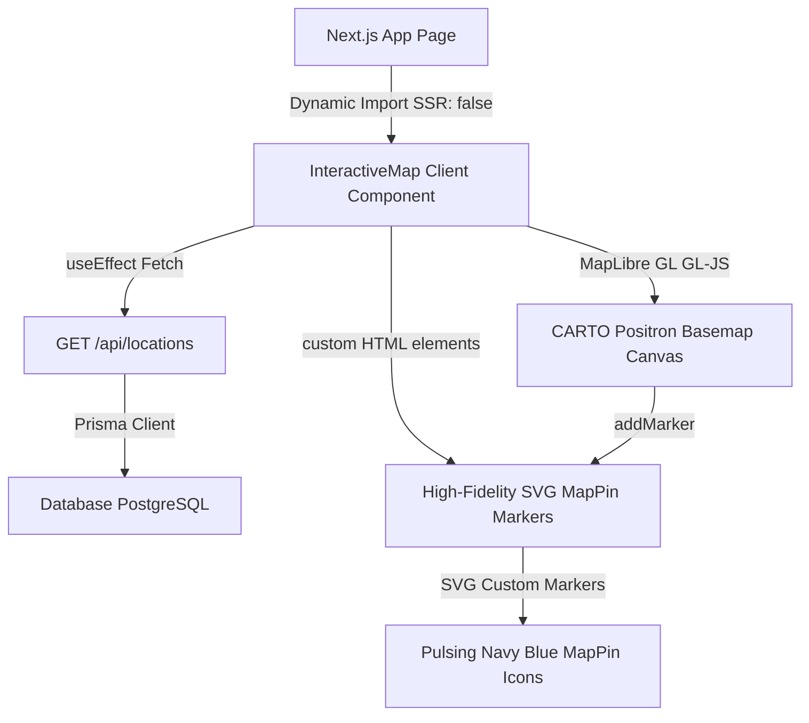

# 🗺️ Módulo de Mapa Interactivo (MapLibre GL JS + Lucide SVG Markers)

Este documento detalla la arquitectura, el diseño visual y el flujo técnico implementado para la sección de mapa de locales y sucursales en la página principal de Ventus.

---

## 🏗️ 1. Arquitectura de la Integración

Para lograr un rendimiento geoespacial fluido y evitar cualquier tipo de degradación de velocidad o incompatibilidad en el framework de Next.js, diseñamos una integración híbrida:



### ⚛️ Desacoplamiento del Ciclo de Vida de React 19
Los frameworks de mapas en React suelen requerir wrappers de contextos (como `react-map-gl`). Sin embargo, debido a la juventud de React 19, estos wrappers suelen arrojar alertas de dependencias obsoletas (`peer dependencies` de React 18).
Para resolver esto de raíz y garantizar una estabilidad del 100% en producción:
1. Inicializamos la instancia de **MapLibre GL JS** (`maplibregl.Map`) de manera nativa en el DOM del navegador a través de un `ref` de React en un `useEffect`.
2. Empleamos marcadores **HTML personalizados** inyectando directamente el SVG exacto de **Lucide React `MapPin`**. Esto nos permite total libertad estética para aplicar efectos dinámicos de selección.
3. El ciclo de vida e interactividad de los marcadores ante selecciones se procesa mediante un efecto reactivo (`useEffect`) que accede directamente al elemento DOM del marcador, aplicando transformaciones `scale(1.25)` y rellenando el SVG de manera instantánea sin re-renderizar ni reconstruir el mapa.

---

## 🌀 2. Flujo de Datos y Centroidización Dinámica

El flujo de información geoespacial se ejecuta de forma completamente automática y adaptativa al ciclo de vida del cliente:

1. **Consulta REST**: Al montarse en el cliente, el componente realiza una petición fetch a `/api/locations`.
2. **Filtrado y Tipado**: Se filtran y sanean las sucursales descartando coordenadas inválidas o nulas.
3. **Cálculo de Bounding/Centroide**:
   Para asegurar que el mapa aparezca perfectamente centrado sobre la zona geográfica real de los locales de la barbería (sin importar si hay una sucursal en San Nicolás, Capital Federal o múltiples provincias):
   $$\text{Centroide Lat} = \frac{\sum_{i=1}^{n} \text{Lat}_i}{n}$$
   $$\text{Centroide Lng} = \frac{\sum_{i=1}^{n} \text{Lng}_i}{n}$$
   Este promedio matemático se calcula en tiempo real al cargar los datos y se asigna como el `center` inicial en la configuración de MapLibre.
4. **Cámara Interactiva (`flyTo`)**:
   Al hacer clic en cualquier tarjeta de la barra lateral, se acciona una transición suave del viewport de MapLibre empleando cálculos de aceleración y desaceleración fluida:
   ```typescript
   map.flyTo({
       center: [longitude, latitude],
       zoom: 16,
       speed: 1.2,
       curve: 1.4
   });
   ```

---

## 🎨 3. Estructura y Estética Visual (Estilo Premium)

- **Basemap Minimalista**: Consumimos la capa vectorial gratuita de **CARTO Positron** (`https://basemaps.cartocdn.com/gl/positron-gl-style/style.json`). Esta capa provee mapas minimalistas en tonos grises muy claros y tipografía fina que no compite visualmente con el diseño minimalista de la barbería y resalta de forma suprema los acentos de marca.
- **Lucide SVG Markers**:
  - Renderiza el pin exacto de la marca con bordes finos.
  - **Estado Neutral (Inactivo)**: El pin se presenta en color gris suave (`#a8a29e` / `stone-400`) y con fondo transparente para mantener el mapa extremadamente limpio.
  - **Estado Activo (Seleccionado)**: El pin escala suavemente a **`1.25x`**, se traslada ligeramente en el eje vertical (`translateY(-2px)`), se posiciona por encima de los demás (`zIndex: 10`), se rellena por completo en color **Azul Royal Premium (`#0b3a60`)**, y su círculo interior se tiñe de blanco para crear una visualización de altísima gama.
- **Cero Redondeados (`rounded-none`)**: Todos los elementos (barra lateral, tarjetas de locales, e info cards flotantes en el mapa) conservan bordes rectos y minimalistas, en plena consistencia con el diseño de Apple y Three.js.

---

## 🛠️ 4. Componentes y Servicios

- **`src/components/InteractiveMap.tsx`**: Componente maestro auto-contenido y responsive.
- **Filtro de SSR**: Cargado en `src/app/page.tsx` con Next.js dynamic loader:
  ```typescript
  const InteractiveMap = dynamic(() => import("@/components/InteractiveMap"), {
      ssr: false,
      loading: () => <ShimmerLoader />
  });
  ```
- **Prisma Schema (`prisma/schema.prisma`)**:
  ```prisma
  model Location {
    id        String   @id @default(cuid())
    name      String
    address   String
    latitude  Float?
    longitude Float?
    // relaciones...
  }
  ```

---

## 🚀 5. Posibles Mejoras Futuras

1. **Agrupamiento (Clustering) Nativo**: Utilizar el agrupamiento de fuentes nativo de MapLibre en caso de tener cientos de sucursales geográficamente distantes.
2. **Capa 3D de Edificios**: Activar la extrusión en 3D de los edificios del mapa circundante (`fill-extrusion` de MapLibre) para dotar de una profundidad urbana tridimensional increíble.
3. **Pulsos Dinámicos CSS**: Agregar micro-animaciones CSS de expansión (`animate-ping`) al marcador seleccionado para darle mayor dinamismo.
