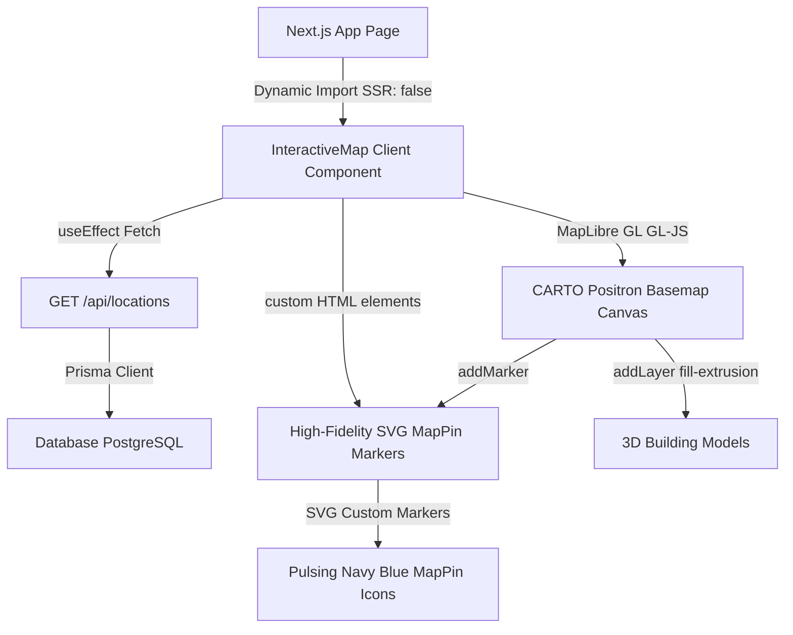

# 🗺️ Módulo de Mapa Interactivo (MapLibre GL JS + 3D Building Extrusions)

Este documento detalla la arquitectura, el diseño visual, el soporte responsivo avanzado y el flujo técnico implementado para la sección de mapa de locales y sucursales en la página principal de Ventus.

---

## 🏗️ 1. Arquitectura de la Integración

Para lograr un rendimiento geoespacial tridimensional fluido y evitar cualquier tipo de degradación de velocidad o incompatibilidad en el framework de Next.js, diseñamos una integración híbrida:



### ⚛️ Desacoplamiento del Ciclo de Vida de React 19
Los frameworks de mapas en React suelen requerir wrappers de contextos (como `react-map-gl`). Sin embargo, debido a la juventud de React 19, estos wrappers suelen arrojar alertas de dependencias obsoletas (`peer dependencies` de React 18).
Para resolver esto de raíz y garantizar una estabilidad del 100% en producción:
1. Inicializamos la instancia de **MapLibre GL JS** (`maplibregl.Map`) de manera nativa en el DOM del navegador a través de un `ref` de React en un `useEffect`.
2. Empleamos marcadores **HTML personalizados** inyectando directamente el SVG exacto de **Lucide React `MapPin`**. Esto nos permite total libertad estética para aplicar efectos dinámicos de selección.
3. El ciclo de vida e interactividad de los marcadores ante selecciones se procesa mediante un efecto reactivo (`useEffect`) que accede directamente al elemento DOM del marcador, aplicando transformaciones `scale(1.25)` y rellenando el SVG de manera instantánea sin re-renderizar ni reconstruir el mapa.

---

## 🌀 2. Flujo de Datos y Centroidización Dinámica

El flujo de información geoespacial se ejecuta de forma completamente automática y adaptativa al ciclo de vida del cliente:

1. **Consulta REST**: Al montarse en el cliente, el componente realiza una petición fetch a `/api/locations`.
2. **Filtrado y Tipado**: Se filtran y sanean las sucursales descartando coordenadas inválidas o nulas.
3. **Cálculo de Bounding/Centroide**:
   Para asegurar que el mapa aparezca perfectamente centrado sobre la zona geográfica real de los locales de la barbería (sin importar si hay una sucursal en San Nicolás, Capital Federal o múltiples provincias):
   $$\text{Centroide Lat} = \frac{\sum_{i=1}^{n} \text{Lat}_i}{n}$$
   $$\text{Centroide Lng} = \frac{\sum_{i=1}^{n} \text{Lng}_i}{n}$$
   Este promedio matemático se calcula en tiempo real al cargar los datos y se asigna como el `center` inicial en la configuración de MapLibre.
4. **Cámara Interactiva y Perspectiva 3D (`flyTo`)**:
   Al hacer clic en cualquier tarjeta de la barra lateral, se acciona una transición suave del viewport de MapLibre empleando cálculos de aceleración y desaceleración fluida, inclinando y rotando la cámara para apreciar fachadas urbanas en relieve:
   ```typescript
   map.flyTo({
       center: [longitude, latitude],
       zoom: 16.5,
       pitch: 55, // Inclinación acentuada 3D
       bearing: -15, // Ligera rotación
       speed: 1.2,
       curve: 1.4
   });
   ```

---

## 🏢 3. Capa de Extrusión de Edificios 3D (Relieve Urbano)

Para dotar al mapa de una profundidad tridimensional increíble sin comprometer la velocidad, inyectamos dinámicamente un sombreador vectorial de extrusión en el evento de carga del mapa:

- **Detección Dinámica de Fuentes**: Consultamos las fuentes activas del basemap para vincular de forma automática el ID de vector tiles (`openmaptiles` o equivalente de CARTO).
- **Inyección por debajo de Etiquetas**: Localizamos el primer ID de la capa de símbolos de etiquetas y texto del mapa e inyectamos la extrusión **por debajo de ella**, garantizando que los nombres de las calles y locales sigan siendo 100% legibles.
- **Rendimiento Visual Premium**:
  - **Inclinación de Cámara**: Se pre-configuran parámetros de `pitch: 45` y `bearing: -10` por defecto en el mapa.
  - **Color Stone Acoplado**: Pintamos las caras de los edificios tridimensionales con una interpolación lineal de colores según su altura en base a la paleta minimalista *stone* (desde `#e7e5e4` / `stone-200` para casas bajas hasta `#a8a29e` / `stone-400` para rascacielos) con una opacidad elegante del `65%`.

---

## 📱 4. Diseño Responsivo Avanzado (Mobile-First Masterclass)

Para proveer una experiencia premium equivalente a las aplicaciones nativas de iOS (como Apple Maps) y evitar la saturación del viewport en dispositivos móviles, rediseñamos el layout en base al ancho de pantalla:

| Elemento | Diseño en Escritorio (Desktop) | Diseño en Móviles (Mobile / Tablet) |
| :--- | :--- | :--- |
| **Distribución Grid** | Columnas estables: `lg:grid-cols-12` (4/12 para Sidebar, 8/12 para Mapa). | Dirección vertical fluida (`flex flex-col`). |
| **Barra de Sucursales** | Listado de tarjetas apiladas en columna vertical (`flex-col`) con scroll vertical. | Fila horizontal (`flex-row overflow-x-auto`) con soporte nativo de **Snap Points (`snap-x snap-mandatory flex-shrink-0`)** para deslizar de forma táctil y fluida. |
| **Información del Local** | Leyenda flotante elegante (`absolute z-30`) posicionada en la esquina inferior izquierda del mapa. | Oculta de forma interna en el mapa (`hidden lg:block`). En su lugar, el card activo del carrusel **se expande dinámicamente en altura** para renderizar teléfono y horarios inline (`lg:hidden`). |
| **Viewport del Mapa** | Altura fija de 600px en armonía con la barra lateral. | Altura optimizada a `380px`/`450px` para dejar espacio libre para desplazamientos táctiles rápidos. |

---

## 🎨 5. Estructura y Estética Visual (Estilo Premium)

- **Basemap Minimalista**: Consumimos la capa vectorial de **CARTO Positron Light** (`https://basemaps.cartocdn.com/gl/positron-gl-style/style.json`). Esta capa resalta de forma suprema los acentos de marca.
- **Lucide SVG Markers**:
  - **Estado Neutral (Inactivo)**: El pin se presenta en color gris suave (`#a8a29e` / `stone-400`).
  - **Estado Activo (Seleccionado)**: El pin escala suavemente a **`1.25x`**, se traslada ligeramente en el eje vertical (`translateY(-2px)`), se posiciona por encima (`zIndex: 10`), se rellena por completo en color **Azul Royal Premium (`#0b3a60`)**, y su círculo interior se tiñe de blanco.
- **Cero Redondeados (`rounded-none`)**: Todos los elementos (barra lateral, tarjetas de locales, e info cards flotantes en el mapa) conservan bordes rectos y minimalistas.
